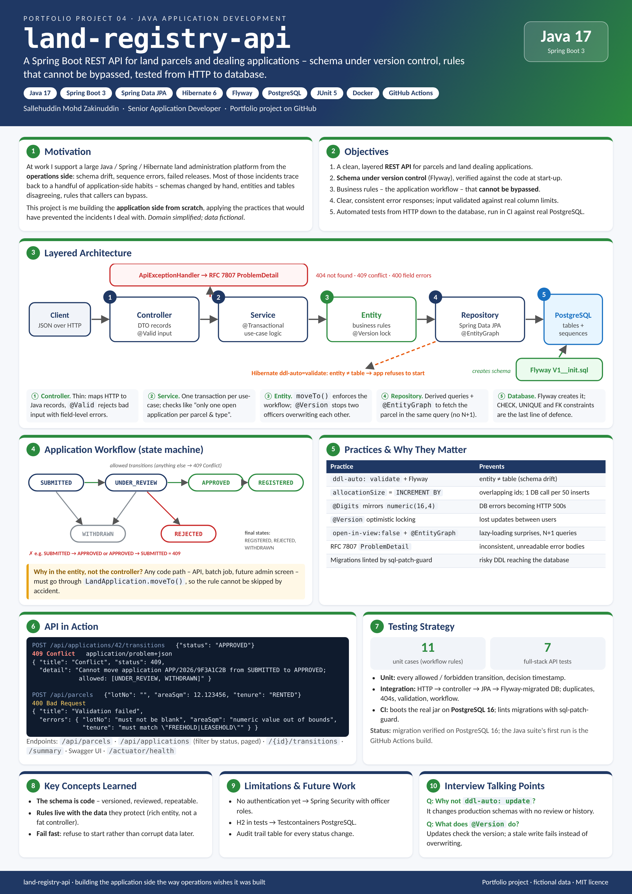

# land-registry-api


| [How to use](docs/USAGE.md) | [Design document](docs/DESIGN.md) | [Poster (PDF, A3)](docs/poster.pdf) | [Changelog](CHANGELOG.md) |
|---|---|---|---|

<a href="docs/poster.png"></a>

A small REST API for land parcels and land dealing applications (transfer, charge, lease, caveat), built with
**Java 17, Spring Boot 3, Spring Data JPA / Hibernate, Flyway and PostgreSQL**.

I work in operations on a large Java/Spring/Hibernate land administration platform, where most of my time goes
into the database and release side: keeping JPA entities and live schemas in line, resolving sequence and constraint
issues, and running releases. This project is me building the application side from scratch, using the
practices I wish every module followed. *Domain and data are fictional and simplified.*

## What it shows

| Practice | Where |
|---|---|
| **Flyway owns the schema, Hibernate only validates it** (`ddl-auto: validate`) - the app refuses to start if an entity and the database disagree | `db/migration/V1__init.sql`, `application.yml` |
| Sequence-based ids where `allocationSize` matches the sequence `INCREMENT BY` (one DB call per 50 inserts; a mismatch risks overlapping ids) | `Parcel`, `LandApplication` |
| Column sizes mirrored in validation (`numeric(16,4)` -> `@Digits(integer = 12, fraction = 4)`) so bad input is a 400, not a database error | `ParcelDtos` |
| Status workflow enforced inside the entity, so no caller can skip it | `ApplicationStatus`, `LandApplication.moveTo` |
| Optimistic locking with `@Version` | `LandApplication` |
| `open-in-view: false` plus `@EntityGraph` fetches - no lazy loading surprises, no N+1 queries | `LandApplicationRepository` |
| RFC 7807 problem responses with per-field validation errors | `ApiExceptionHandler` |
| Integration tests over HTTP -> JPA -> Flyway-migrated database; CI also boots the jar against real PostgreSQL | `LandRegistryApiTests`, `.github/workflows/ci.yml` |
| Health/liveness endpoints, non-root Docker image | Actuator, `Dockerfile` |
| Migrations linted in CI with my own [sql-patch-guard](https://github.com/sllhddn/sql-patch-guard) | `.github/workflows/ci.yml` |

## Application workflow

```
SUBMITTED -> UNDER_REVIEW -> APPROVED -> REGISTERED
    |              |      \
    +-> WITHDRAWN  +-> WITHDRAWN / REJECTED
```

Illegal moves (e.g. `SUBMITTED -> APPROVED`) return **409 Conflict**. A parcel can have only one open application
of each type at a time.

## Run it

```bash
docker compose up --build           # PostgreSQL + API on :8080
```

or with a local PostgreSQL:

```bash
mvn spring-boot:run                 # DB_URL / DB_USER / DB_PASSWORD env vars, defaults in application.yml
mvn verify                          # tests (in-memory H2 in PostgreSQL mode)
```

- Swagger UI: http://localhost:8080/swagger-ui.html
- Health: http://localhost:8080/actuator/health
- Sample calls: `requests.http` (IntelliJ / VS Code REST Client)

## Endpoints

| Method | Path | Purpose |
|---|---|---|
| POST | `/api/parcels` | register a parcel |
| GET | `/api/parcels`, `/api/parcels/{id}` | list (paged) / fetch |
| POST | `/api/applications` | submit an application for a parcel |
| GET | `/api/applications?status=UNDER_REVIEW` | list, filter by status (paged) |
| GET | `/api/applications/{id}` | fetch |
| POST | `/api/applications/{id}/transitions` | move to the next status `{"status": "APPROVED", "remarks": "..."}` |
| GET | `/api/applications/summary` | count per status |

## Ideas for next steps

- Testcontainers instead of H2 for the integration tests
- Spring Security with role-based access (counter staff vs. approving officer)
- Audit trail table for every status change

## License

MIT
