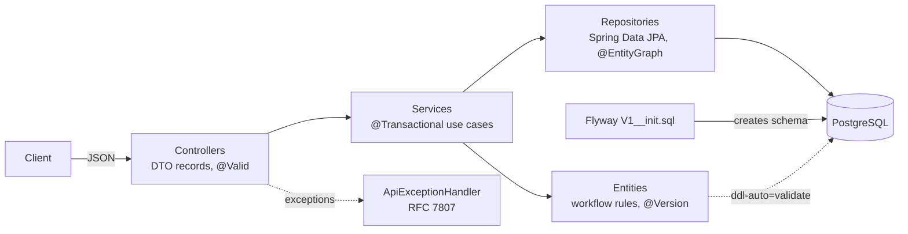
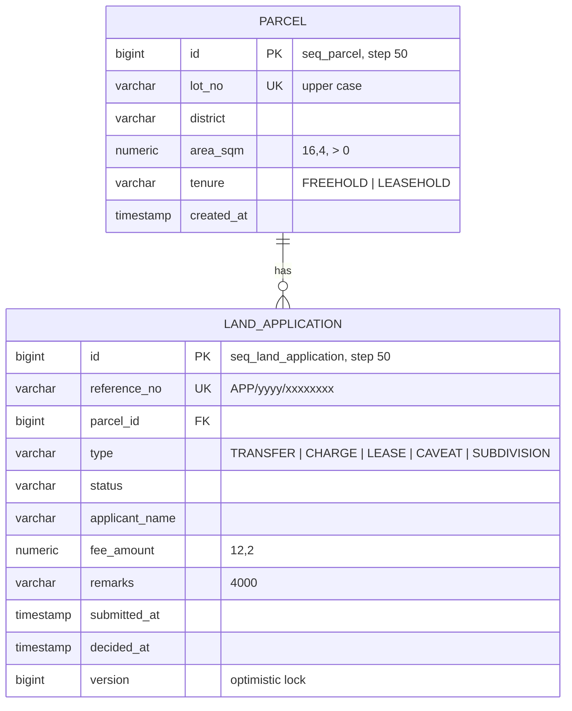
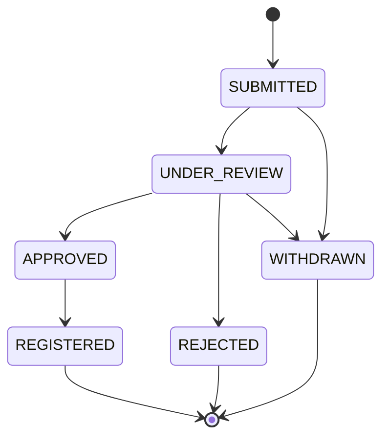

# land-registry-api: Design document

| | |
|---|---|
| Author | Sallehuddin Mohd Zakinuddin |
| Status | v1.0.0 written; first build runs in GitHub Actions |
| Last updated | November 2026 |

## 1. Context

Land administration systems record parcels of land and the dealings on them (transfers, charges, leases, caveats).
Each dealing is an application that moves through review and approval before it is registered against the parcel.

I support a large system of this kind from the operations side. Many incidents there trace back to application-side
habits: schemas changed by hand and out of step with the entities, sequence settings that disagree with the ORM,
business rules enforced only in the user interface, and lazy loading that fails or floods the database. This project
builds a small version of the domain with practices that prevent those incidents. The domain is simplified and all
data is fictional.

## 2. Goals and non-goals

**Goals**

1. A layered REST API for parcels and dealing applications.
2. The database schema is versioned (Flyway) and verified against the entities on every start-up.
3. The application workflow cannot be bypassed by any caller.
4. Consistent, readable errors; input limits match column limits.
5. Tests that run from HTTP down to the database.

**Non-goals (this version)**

- Authentication and authorisation.
- Document storage, payments, survey plans.
- A user interface (Swagger UI is enough to exercise the API).

## 3. Architecture

| Layer | Responsibility | Rule |
|---|---|---|
| Controller | Map HTTP to Java records, validate input | No business logic |
| Service | One transaction per use case; cross-entity checks | Only place that calls repositories |
| Entity | Own its invariants (`LandApplication.moveTo`) | State changes only through methods |
| Repository | Queries, fetch plans | No logic |

## 4. Domain model

### Application workflow

`ApplicationStatus.allowedNext()` defines the arrows; `LandApplication.moveTo()` refuses anything else with a
409 Conflict. `decided_at` is stamped on APPROVED or REJECTED.

## 5. Key decisions

| # | Decision | Alternatives | Reason |
|---|---|---|---|
| 1 | Flyway owns the schema; Hibernate runs `ddl-auto=validate` | `ddl-auto=update` | `update` changes production schemas with no review or history and never narrows or drops safely. `validate` makes a mismatch stop the application at start-up instead of corrupting data later |
| 2 | Sequence ids with `allocationSize = 50` and `INCREMENT BY 50` | `IDENTITY` columns; allocation 1 | Pooled sequences need one database call per 50 inserts and allow JDBC batching. The two numbers must match, or ids handed out by Hibernate can overlap with ids other writers get from the sequence |
| 3 | Workflow rules inside the entity | Checks in the controller or service | Any future caller (batch job, admin screen) goes through `moveTo()`, so the rule cannot be skipped by accident |
| 4 | `@Version` optimistic locking | Pessimistic locks; none | Two officers editing the same application cannot silently overwrite each other; no long-held database locks |
| 5 | `open-in-view: false` plus `@EntityGraph` on reads | Open Session in View | Every database access happens inside the service transaction. Graphs load the parcel with the application in one query, avoiding N+1 selects |
| 6 | Validation mirrors column limits (`@Digits(12,4)` for `numeric(16,4)`, `@Size` for varchar) | Rely on database errors | Bad input becomes a clear 400 with the field name, not a 500 from a constraint violation |
| 7 | RFC 7807 `ProblemDetail` for all errors | Custom error JSON | A standard shape that clients and gateways already understand |
| 8 | Own `PageResponse` record for paged results | Serialise Spring's `PageImpl` | A stable JSON contract that does not change with framework versions |
| 9 | Enums stored as `VARCHAR` with CHECK constraints | Ordinal integers; native enum types | Readable in SQL, safe to reorder in Java, portable across databases |

## 6. API contract

| Method | Path | Success | Errors |
|---|---|---|---|
| POST | `/api/parcels` | 201 + Location | 400, 409 duplicate lot |
| GET | `/api/parcels`, `/api/parcels/{id}` | 200 | 404 |
| POST | `/api/applications` | 201 + Location | 400, 404 parcel, 409 open application |
| GET | `/api/applications?status=` | 200 paged | |
| GET | `/api/applications/{id}` | 200 | 404 |
| POST | `/api/applications/{id}/transitions` | 200 | 400, 404, 409 not allowed |
| GET | `/api/applications/summary` | 200 | |

## 7. Testing strategy

| Level | Tests | What they prove |
|---|---|---|
| Unit | `ApplicationStatusTest` (11 cases) | Every allowed and forbidden transition; final states; `decided_at` stamping |
| Integration | `LandRegistryApiTests` (7 tests) | HTTP → controller → service → JPA → Flyway-migrated H2: duplicate lots, field errors, 404s, full workflow, one-open-application rule, filtering, summary, health |
| Schema | Every test run | Context starts only if entities match the migration (`ddl-auto=validate`) |
| PostgreSQL (CI) | Second job | Builds the jar, boots it against PostgreSQL 16, smoke-tests the API |
| Migration lint (CI) | sql-patch-guard | The migration has no risky statements |

The migration `V1__init.sql` has also been run directly against PostgreSQL 16 and linted with sql-patch-guard
(0 errors, 0 warnings).

## 8. Security considerations

- No authentication yet; do not expose this build publicly.
- All queries use JPA parameters; no string-built SQL.
- Lot numbers and names are validated for length; enums are validated by type.
- The Docker image runs as a non-root user.

## 9. Future work

1. Spring Security with roles: counter staff can submit, officers can review, approvers can approve.
2. Testcontainers PostgreSQL instead of H2 for integration tests.
3. An audit table recording every status change with who and when.
4. Search by lot number and district; parcel history view.
